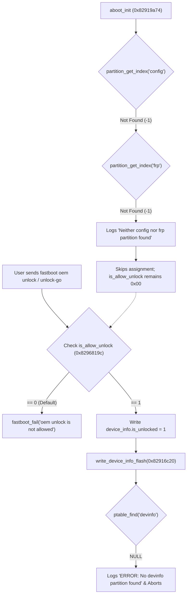

# JioFi 4 (JMR1140): Bootloader Unlocking Feasibility & Read/Debug Capabilities

**Target Binary:** `aboot-original.bin` (Little Kernel / ARM 32-bit ELF, extracted from `/dev/mtd7ro`)  
**SHA-256:** `8982b2585813221fafc52683233f48768e6eff795946484f622ec46bad9d7946`  
**SoC Platform:** Qualcomm MDM9607 (Cortex-A7 AP + Hexagon QDSP6 V5 Modem + TrustZone Secure World)  
**Storage Architecture:** Raw SLC NAND via Qualcomm QPIC Controller (MIBIB Partition Scheme)

---

## 1. Executive Summary & Definitive Verdicts

```
┌────────────────────────────────────────────────────────────────────────┐
│                        CORE VERDICTS SUMMARY                           │
├────────────────────────────────────────────────────────────────────────┤
│ 1. Stock Bootloader Unlocking Feasibility:                             │
│    ❌ IMPOSSIBLE via standard stock fastboot commands                  │
│    - is_allow_unlock (0x8296819c) permanently 0 (requires missing      │
│      'config' or 'frp' NAND partition).                                │
│    - write_device_info_flash fails (requires missing 'devinfo' ptn).   │
│                                                                        │
│ 2. Application Processor (ARM Cortex-A7) Debug Capabilities:           │
│    ✅ EXTENSIVE CAPABILITIES GAINED                                    │
│    - Bypasses verify_signed_bootimg RSA signature checks.              │
│    - Permits 'fastboot boot <debug_kernel.img>' (tethered RAM boot).   │
│    - Enables unconstrained /dev/mem access, full RAM dumps, ftrace.    │
│                                                                        │
│ 3. Modem Baseband (Hexagon QDSP6) & SIM Lock Status:                   │
│    ⚠️ ZERO DIRECT EFFECT ON SIM PERSONALIZATION / CARRIER LOCK         │
│    - Modem firmware is authenticated by Qualcomm TrustZone PIL.        │
│    - SIM Lock (NV 2666 / 2672 / MMGSDI) runs exclusively inside DSP.   │
│    - Unlocking AP aboot does NOT allow an Airtel SIM to connect.       │
└────────────────────────────────────────────────────────────────────────┘
```

---

## 2. Fastboot Command Dispatch Architecture

Disassembly of `aboot_fastboot_register_commands` ([`0x8291959c`](file:///home/shubham/lab/jiofi/JioFi-4-JMR1140/aboot-original.bin#L1)) shows that `aboot` registers 15 fastboot commands from dispatch table `0x82944d18`:

```
[Entry  1]  "flash:"                    -> 0x82919520 (cmd_flash)
[Entry  2]  "erase:"                    -> 0x82918650 (cmd_erase)
[Entry  3]  "boot"                      -> 0x82918010 (cmd_boot)
[Entry  4]  "continue"                  -> 0x829176a4 (cmd_continue)
[Entry  5]  "reboot"                    -> 0x82914f74 (cmd_reboot)
[Entry  6]  "reboot-bootloader"         -> 0x82914fc8 (cmd_reboot_bootloader)
[Entry  7]  "oem unlock"                -> 0x82915020 (cmd_oem_unlock)
[Entry  8]  "oem unlock-go"             -> 0x82917ac0 (cmd_oem_unlock_go)
[Entry  9]  "oem lock"                  -> 0x82917ba8 (cmd_oem_lock)
[Entry 10]  "oem verified"              -> 0x82917c20 (cmd_oem_verified)
[Entry 11]  "oem device-info"           -> 0x82914e78 (cmd_oem_devinfo)
[Entry 12]  "preflash"                  -> 0x82914e38 (cmd_preflash)
[Entry 13]  "oem enable-charger-screen" -> 0x8291797c (cmd_oem_enable_charger_screen)
[Entry 14]  "oem disable-charger-screen"-> 0x829179e0 (cmd_oem_disable_charger_screen)
[Entry 15]  "oem select-display-panel"  -> 0x82917a44 (cmd_oem_select_display_panel)
```

---

## 3. The Triple Blockade: Why Stock Unlocking is Impossible



### 1. `is_allow_unlock` Global Gate (VA `0x8296819c`)
- In Little Kernel, `is_allow_unlock` resides in `.bss` and defaults to `0x00`.
- In `aboot_init` (`0x82919a74`–`0x82919c20`), `aboot` looks up partition `"config"` or `"frp"`:
  ```assembly
  82919a80: bl   0x829045d4  ; partition_get_index("config")
  82919a8c: cmn  r0, #1      ; == -1 (INVALID_PTN)?
  82919a94: beq  0x82919bf4  ; branch to fallback!
  ...
  82919bf8: bl   0x829045d4  ; partition_get_index("frp")
  82919bfc: cmn  r0, #1
  82919c08: movw r1, #0x7e84 ; "config"
  82919c0c: movw r0, #0x62b0 ; "Neither '%s' nor '%s' partition found"
  82919c1c: bl   0x8291d1cc  ; _dprintf()
  82919c20: b    0x82919af8  ; BRANCH SKIPS str r2, [is_allow_unlock]!
  ```
- Because neither partition exists in raw NAND MIBIB, `is_allow_unlock` is permanently `0`.

### 2. Embedded Linux vs. Android Userspace Gap
- On Android phones, `is_allow_unlock` is enabled via "OEM Unlocking" in Developer Options (via Android `PersistentDataBlockManagerService`).
- On JioFi 4, the OS is OpenEmbedded Linux (Poky 3.18). The path `/config` in userspace is merely a filesystem symlink (`ln -sf /data/configs /config`) on UBIFS volume `userdata` (`mtd17`). `aboot` reads raw NAND partition blocks; filesystem symlinks are invisible to it.

### 3. Missing Persistent `devinfo` Partition
- In `write_device_info_flash` (`0x82916c20`), the bootloader queries `ptable_find(ptable, "devinfo")`.
- On NAND JMR1140, there is no `devinfo` partition in the partition table. The write function immediately logs `ERROR: No devinfo partition found` and aborts.

---

## 4. Deep-Dive: Image Verification Bypass in Unlocked State

Static disassembly reveals the exact conditional branches controlled by `device_info.is_unlocked`:

### In `cmd_boot` (`0x82918158`–`0x82918178`):
```assembly
82918158: bl   target_use_signed_kernel
82918164: movw r3, #0x7e94
82918168: movt r3, #0x8295            ; r3 = 0x82957e94 (device_info)
8291816c: ldr  r3, [r3, #16]          ; r3 = device_info.is_unlocked
82918170: cmp  r3, #0
82918174: beq  0x829183ec             ; IF is_unlocked == 0 -> verify_signed_bootimg!
                                      ; IF is_unlocked == 1 -> BYPASSES ALL SIGNATURE CHECKS!
```

### In `boot_linux_from_flash` (`0x82916f98`–`0x82916fc0`):
```assembly
82916f98: bl   target_use_signed_kernel
82916fa8: movw r2, #0x7e94
82916fac: movt r2, #0x8295            ; r2 = 0x82957e94 (device_info)
82916fb4: ldr  r2, [r2, #16]          ; r2 = device_info.is_unlocked
82916fb8: cmp  r2, #0
82916fbc: beq  0x829172a8             ; IF is_unlocked == 0 -> verify_signed_bootimg!
                                      ; IF is_unlocked == 1 -> FALLTHROUGH TO DIRECT BOOT!
```

> [!NOTE]
> If `device_info.is_unlocked == 1`, `aboot` completely skips `verify_signed_bootimg` (`0x82915eb8`) and OpenSSL RSA signature validation against the embedded Qualcomm test certificate (`0x82942ef8`).

---

## 5. Subsystem Capabilities Matrix: What Unlocking Provides vs. Protects

```
┌────────────────────────────────────────────────────────────────────────┐
│                        QUALCOMM MDM9607 SOC                            │
├────────────────────────────────────────┬───────────────────────────────┤
│    NON-SECURE APPLICATION PROCESSOR    │      SECURE & BASEBAND WORLD  │
│         (ARM Cortex-A7)                │                               │
│                                        │  ┌─────────────────────────┐  │
│  ┌──────────────────────────────────┐  │  │  QUALCOMM TRUSTZONE     │  │
│  │ Little Kernel Bootloader (aboot) │  │  │  (QSEE / TZ - ARM Sec)  │  │
│  │   [Controls is_unlocked flag]    │  │  │  - Hardware XPU Firewalls│ │
│  └──────────────────┬───────────────┘  │  │  - QFPROM SecBoot Fuses │  │
│                     │                  │  └────────────┬────────────┘  │
│                     ▼                  │               │               │
│  ┌──────────────────────────────────┐  │               │ Authenticates │
│  │ Linux Kernel (Poky 3.18)         │  │               │ via PIL SCM   │
│  │ - Boots custom / unsigned image  │  │               ▼               │
│  │ - Unlocks /dev/mem & ftrace      │  │  ┌─────────────────────────┐  │
│  │ - Full root & debug capabilities │  │  │  MODEM HEXAGON DSP      │  │
│  │ - Intercepts QMI/SMEM IPC        │  │  │  (QDSP6 V5 / QuRT RTOS) │  │
│  └──────────────────────────────────┘  │  │  - MMGSDI Perso Engine  │  │
│                                        │  │  - NV 2666 / 2672 Lock  │  │
│                                        │  │  - Conformance NV 947   │  │
│                                        │  │  - ZERO EFFECT FROM AP! │  │
│                                        │  └─────────────────────────┘  │
└────────────────────────────────────────┴───────────────────────────────┘
```

### 1. Application Processor (AP - ARM Cortex-A7) Capabilities Gained
- **Unsigned Kernel Execution:** Bypasses RSA-2048 verification, allowing custom Linux kernels.
- **Tethered Ephemeral Boot (`fastboot boot debug.img`):** Booting an in-memory kernel over USB without writing to NAND.
- **Physical Memory Inspection:** Compiling kernels with `CONFIG_STRICT_DEVMEM=n` to access physical memory (`/dev/mem`), peripheral registers (QPIC NAND controller, TLMM GPIOs, clocks), and perform full DDR RAM dumps.
- **Full Kernel Tracing:** Enabling `ftrace`, `kprobes`, `perf`, and custom debugging modules.
- **Raw NAND Forensics:** Bit-exact dumps of raw flash pages and spare OOB areas, bypassing UBIFS wear-leveling and bad-block translation.

### 2. Modem Baseband (Hexagon QDSP6 V5) - ZERO Direct Effect
- **TrustZone PIL Authentication:** Modem firmware (`modem.elf` on `mtd10`) is verified by Qualcomm TrustZone PIL (`pil-q6v5-mss`) using cryptographic signatures before the Hexagon core is released from reset. AP bootloader unlocking does not affect TrustZone PIL authentication.
- **SIM Personalization Independence:** Qualcomm SIM Personalization (NV Items 2666, 2672, and conformance NV 947) runs entirely within the Hexagon DSP MMGSDI task (`mmgsdi_perso.c`). Unlocking the AP bootloader does **not** bypass carrier locks and will **not** allow an Airtel SIM to attach.
- **Indirect Sniffing Gained:** With an unlocked AP kernel, an engineer can capture 100% of raw QMI IPC traffic (`/dev/smdcntl0`, `/dev/smd0`, `smd_pkt`), unfiltered DIAG packets (`/dev/diag`), and shared memory tables (Qualcomm SMEM Item 335 `eng_mode`).

### 3. Qualcomm TrustZone (QSEE / TZ) - Protected
- **Hardware Memory Protection (XPU):** Qualcomm hardware memory protection units isolate TrustZone RAM (`mtd3`). Any AP attempt to read TrustZone RAM results in an immediate hardware bus error / Asynchronous External Abort.
- **Hardware eFuses (QFPROM):** Hardware one-time programmable (OTP) fuses (SecBoot enabled, OEM PK Hash) cannot be modified or bypassed by software bootloader unlock.

---

## 6. Detailed Comparison Matrix

| Feature / Capability | Stock Locked State | Unlocked Bootloader (`is_unlocked = 1`) |
| :--- | :---: | :---: |
| **Standard Fastboot Unlock (`oem unlock`)** | ❌ Blocked (`is_allow_unlock == 0`) | N/A (Already Unlocked) |
| **Ephemeral Boot (`fastboot boot `)** | ❌ Blocked (Fails RSA verify) | ✅ Allowed (Bypasses verify) |
| **Custom Kernel Flashing (`fastboot flash boot`)** | ❌ Boots panic (Tampered assert) | ✅ Boots directly |
| **Custom Recovery Flashing (`recovery`)** | ❌ Signature rejected | ✅ Allowed |
| **Physical AP RAM Inspection (`/dev/mem`)** | ⚠️ Restricted by kernel config | ✅ 100% unconstrained (custom kernel) |
| **Raw NAND MTD Forensic Extraction** | ⚠️ Limited by running OS tools | ✅ Bit-exact block extraction via debug kernel |
| **Real-time QMI / DIAG IPC Sniffing** | ⚠️ Subject to daemon filters | ✅ Complete kernel-level tap |
| **Modem Baseband SIM Unlock (Airtel SIM)** | ❌ Blocked by MMGSDI / NV 2666 | ❌ **STILL BLOCKED** (Isolated in Hexagon DSP) |
| **Custom Modem Firmware Flashing** | ❌ Rejected by TrustZone PIL | ❌ **STILL BLOCKED** (Rejected by TrustZone PIL) |
| **Qualcomm TrustZone Secure RAM Peek** | ❌ Blocked by hardware XPU | ❌ **STILL BLOCKED** (Blocked by hardware XPU) |
