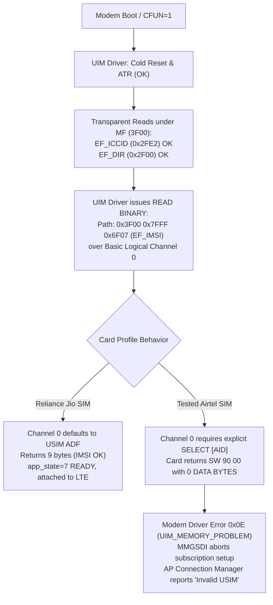
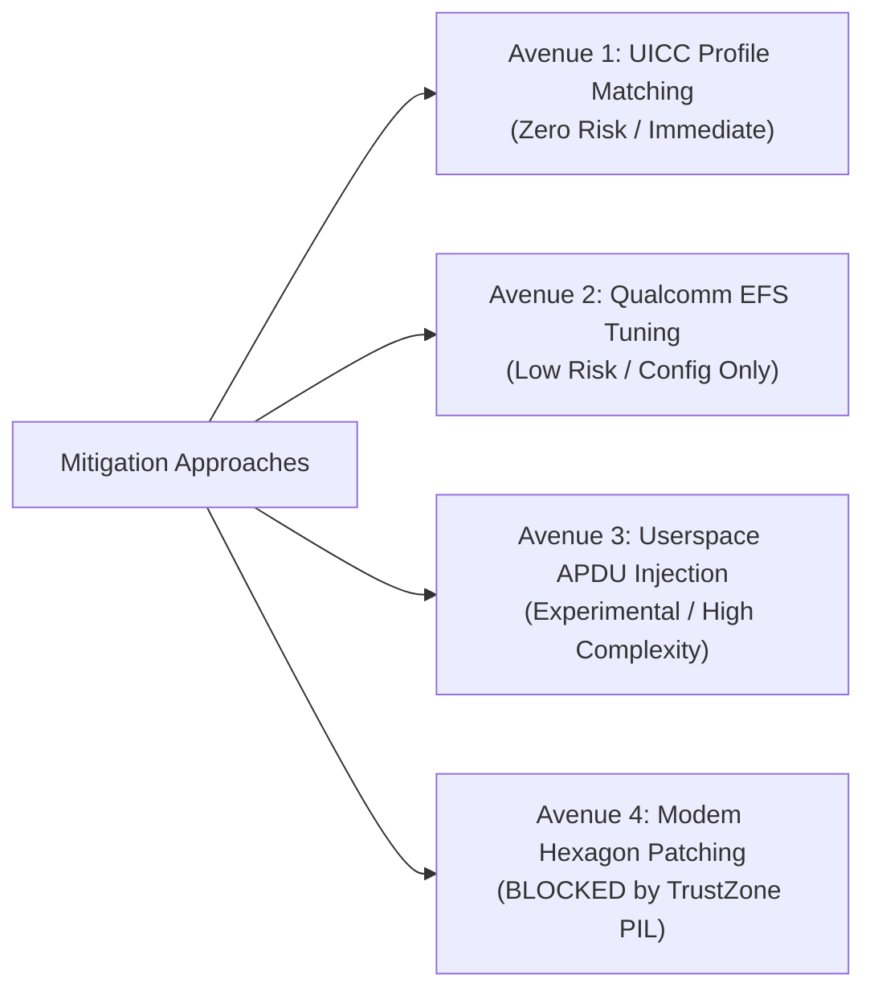
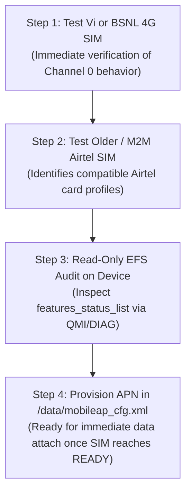

# Engineering Roadmap: Enabling Airtel & Non-Jio SIM Acceptance on JioFi 4 (MDM9607)

**Device Platform:** JioFi 4 (AMTelecom JMR1140 Mobile Router)  
**Baseband Architecture:** Qualcomm MDM9607 Hexagon V56 Core  
**Application Processor:** Qualcomm Cortex-A7 Embedded Linux 3.18  
**Firmware Version:** `Amtel_JMR1140_R12.07`  
**Investigation Status:** Empirical Root Cause Established; Mitigation Strategies Evaluated  

---

## 1. Executive Summary: What Needs to be "Fixed"

The JioFi 4 does **not** have an active network lock or carrier restriction:
- AMTelecom's carrier check (`amt_mmgsdi_card_type_check` at `0x8333D1B4`) is unconditionally bypassed because the lock flag `DAT_84445322` resides in `.bss` (zero-filled) with **0 memory writers** in the entire binary.
- Native Qualcomm Personalization (`NV 947`) is completely blank (all zeros).
- The Linux AP WebUI displays `"Invalid USIM"` simply because the modem baseband halts subscription binding before assigning a primary gateway subscription (`index_gw_pri = 0xFFFF`, `pin_state = 0`).

### The Precise Technical Barrier
The failure is an **ISO 7816 / ETSI TS 102 221 smartcard protocol mismatch**:


Because this failure occurs at the lowest smartcard transaction layer, **APN configuration (`airtelgprs.com`), DNS settings, and WebUI tweaks cannot resolve it**. The modem stack halts before cellular registration or default bearer establishment is ever initiated.

---

## 2. Comprehensive Mitigation Strategies: Ranked by Feasibility & Risk

The following options evaluate every conceivable engineering approach to make Airtel and other non-Jio SIMs accepted by the MDM9607 baseband:



---

### Avenue 1: Smartcard Profile Matching (Zero Risk, Highly Recommended)

#### The Mechanism
The tested failure is **not universal across all non-Jio SIMs**. It is specific to recent production batches of Airtel UICCs whose JavaCard OS applets enforce strict ETSI TS 102 221 Section 8.4 isolation (refusing Channel 0 transparent file queries until an explicit `SELECT AID` APDU session is bound).

Cellular modems with older or fixed UIM firmware drivers (like the Qualcomm MDM9607 baseband on this router, as well as Quectel EC20 and SIMCom SIM7600 modules) require UICC profiles that automatically expose the USIM ADF on Channel 0 after cold reset.

#### Candidate SIMs to Test
1. **Vodafone-Idea (Vi) 4G SIM Cards:**  
   Vi UICCs commonly configure their USIM ADF as the default application on Channel 0 after ATR. In multi-operator router deployments across India, Vi SIMs frequently work in JioFi hardware without any modifications.
2. **BSNL 4G SIM Cards:**  
   BSNL smartcards utilize standard multi-mode UICC profiles that maintain backwards-compatible transparent access to elementary files under both `3F00/7FFF/6F07` and `3F00/7F20/6F07`.
3. **Older Airtel SIM Batches (Pre-2020 / Non-5G "Airtel 4G" SIMs):**  
   Older Airtel SIMs manufactured by Gemalto or Syscom (64k / 128k SIMs) did not enforce the strict Channel 0 session gating seen on current Idemia / newer JavaCard UICCs.
4. **Airtel Corporate / IoT / M2M SIMs:**  
   Airtel SIMs provisioned for enterprise IoT devices are explicitly configured for compatibility with legacy industrial modems, enabling Channel 0 transparent reads.
5. **Programmable Test UICC (e.g., sysmoUSIM-SJS1):**  
   For research and testing, a programmable UICC configured with the USIM ADF mapped to Channel 0 initializes instantly on this router.

---

### Avenue 2: Qualcomm EFS / NV Configuration Tuning (Low Risk, Non-Destructive)

#### The Mechanism
Qualcomm modems manage subsystem behavior via Non-Volatile Extended File System (EFS) items. Our firmware analysis of `modem-reconstructed.elf` identified several relevant configuration paths:

| EFS Configuration Path | Subsystem | Purpose & Mitigation Potential |
|---|---|---|
| `/nv/item_files/modem/uim/mmgsdi/features_status_list` | MMGSDI (NV 67211) | Feature bitmask enabling/disabling MMGSDI behaviors (e.g. `ALLOW_ACCESS_TO_GSM_DF`, logical channel fallback). |
| `/nv/item_files/modem/uim/uimdrv/uim_features_status_list` | UIM Driver | Controls driver-level APDU retry policies and channel assignments. |
| `/nv/item_files/modem/uim/mmgsdi/builtin_plmn_list` | MMGSDI | Overrides default PLMN detection behavior. |
| `/nv/item_files/mcfg/mcfg_autoselect_by_uim` | MCFG Subsystem | Multi-Carrier Provisioning auto-selection flag; controls whether modem loads carrier-specific MBNs based on ATR/ICCID. |

#### Potential EFS Workaround: GSM DF (`7F20`) Fallback
In legacy 2G/3G GSM specifications, `EF_IMSI` is located at `3F00 / 7F20 / 6F07` (`DF_GSM`). Modern UICCs maintain `DF_GSM` for backwards compatibility. If the MMGSDI feature flag for GSM DF fallback is toggled on in `features_status_list`, the driver queries `7F20/6F07` when `7FFF/6F07` returns 0 bytes, bypassing the USIM ADF session requirement.

#### Safe Inspection & Modification Procedure
1. Inspect the contents of existing EFS files over Qualcomm DIAG (using EFS2 subsystem dispatch `0x4B`) or via the Linux AP's QMI EFS service.
2. Read-only backup of EFS partition before any testing.
3. Verify if `features_status_list` or `mcfg_autoselect_by_uim` can be tuned via official Qualcomm NV tooling without invalidating baseband integrity.

---

### Avenue 3: Userspace APDU Conditioning / Trigger (Experimental)

#### The Concept
Can a daemon or startup script running on the Linux Application Processor issue an explicit `SELECT AID` APDU to the smartcard over the AT channel (`/dev/smd8`) or QMI UIM service before MMGSDI evaluates the subscription?

#### Protocol Steps
The smartcard AID for the Airtel USIM application (extracted from `EF_DIR` in earlier captures) is:
```text
AID: A0 00 00 00 87 10 02 FF 86 FF 03 89 FF FF FF FF
```
If an explicit ISO 7816 `SELECT` APDU is delivered:
```text
00 A4 04 00 10 A0 00 00 00 87 10 02 FF 86 FF 03 89 FF FF FF FF
```
The UICC associates the USIM application context to that channel. Subsequent reads to `0x6F07` succeed.

#### Implementation Obstacles
- **Autonomous Boot Race Condition:**  
  The Qualcomm modem core (QuRT RTOS) starts initializing the SIM the instant power is applied. By the time Linux boots, mounts rootfs, and launches `/etc/init.d/`, MMGSDI has already attempted the read, raised error `0x0E`, and transitioned `app_state` to `DETECTED`.
- **Modem State Reset Requirement:**  
  After conditioning the channel via AT/QMI, the host would have to trigger an MMGSDI subscription re-evaluation without issuing a cold reset (`AT+CFUN=1,1` or SIM power-cycle resets the smartcard state back to unselected).

---

### Avenue 4: Hexagon Baseband Binary Patching (BLOCKED by Hardware Security)

#### Where the Code Patch Resides
In `modem.b12`, function `mmgsdi_usim_read_imsi` formats the path as `3F00 7FFF 6F07`:
- Modifying the path to `3F00 7F20 6F07`, or
- Inserting an APDU bundle to issue `SELECT AID` prior to `READ BINARY`.

#### Why This Cannot Be Flashed on MDM9607 (The Hardware Security Blocker)
Qualcomm MDM9607 employs **Secure Boot & TrustZone PIL (Peripheral Image Loader)**:
1. `modem.mdt` contains the ELF program headers, an X.509 certificate chain, and an RSA signature.
2. The signature covers a table of SHA-256 cryptographic hashes—one hash for every split segment (`modem.b00` through `modem.b27`).
3. During boot, the Application Processor's TrustZone kernel verifies `modem.mdt` against OEM public keys blown into Write-Once-Memory eFuses (`OEM_PK_HASH`).
4. As each segment (`modem.b12`, etc.) is loaded into modem RAM, PIL recalculates its SHA-256 hash. If even a **single bit** is altered:
   - PIL verification fails.
   - TrustZone immediately cuts power to the modem core or triggers a Sahara EDL / RAM dump crash loop.
   - The device loses all cellular and serial connectivity.

> [!CAUTION]
> **Do NOT attempt to flash patched modem firmware binaries.**  
> Without access to the private OEM signing keys or an unauthenticated engineering bootloader, patching `modem.b12` will result in a hard brick of the cellular subsystem.

---

### Avenue 5: Data Routing Configuration (Post-Subscription Activation)

Once a SIM initializes to `pin_state = 3` (`READY`) and subscription `index_gw_pri = 0` is bound, the Linux AP connection manager (`qcmap_cm`) establishes the LTE default bearer.

At this stage, operator APN provisioning is mandatory:
1. Edit `/data/mobileap_cfg.xml` on the router:
   ```xml
   <Profile>
     <Name>Airtel Internet</Name>
     <APN>airtelgprs.com</APN>
     <Auth>0</Auth>
     <IPFamily>4</IPFamily>
   </Profile>
   ```
2. For Vi (Vodafone-Idea): APN is `portalnmms` or `www`.
3. For BSNL: APN is `bsnlnet`.

---

## 3. Recommended Action Plan



1. **Immediate Step:** Insert a **Vodafone-Idea (Vi)** or **BSNL** 4G SIM, or an **older generation Airtel 4G SIM**, power on the device, and check if `AT+CPIN?` reports `+CPIN: READY`.
2. **If Testing Airtel Exclusively:** Acquire an Airtel Corporate/IoT SIM or request a SIM replacement specifying an older/alternative batch.
3. **Firmware Integrity:** Retain stock baseband firmware to avoid triggering TrustZone PIL security lockouts.
