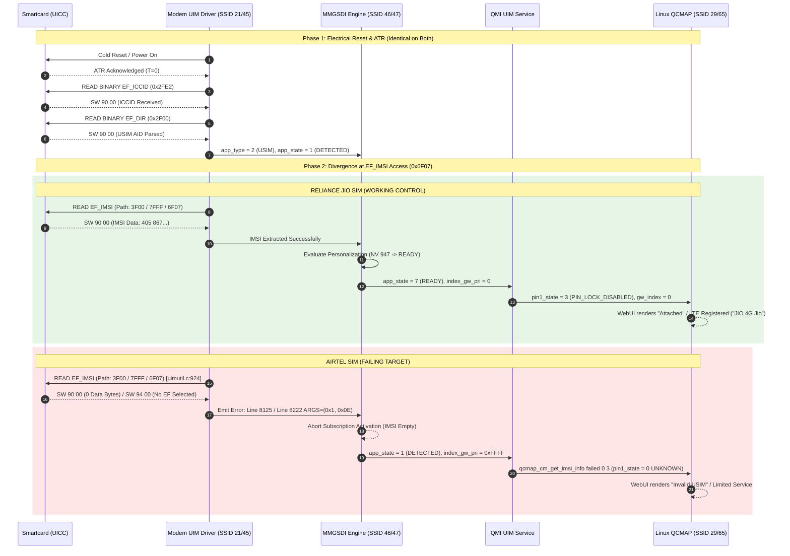

# Empirical Forensic Analysis: Reliance Jio vs. Airtel USIM Initialization

**Platform:** JioFi 4 (AMTelecom JMR1140 / Qualcomm MDM9607 Hexagon Baseband)  
**Methodology:** Live Qualcomm DIAG protocol capture via USB Interface 2 (EP `0x02` OUT / EP `0x83` IN)  
**Airtel Capture Trace:** [`airtel_diag_init_capture.log`](file:///home/shubham/lab/jiofi/captures/airtel_diag_init_capture.log) (5,096 decoded messages / 5,098 raw frames)  
**Jio Baseline Trace:** [`jio_working_sim_init_capture.log`](file:///home/shubham/lab/jiofi/captures/jio_working_sim_init_capture.log) (6,801 decoded messages / 6,803 raw frames)  
**Date:** October 21, 2026  
**Status:** Conclusive Empirical Resolution  

---

## 1. Executive Summary

By capturing and decoding live Qualcomm DIAG packets at sub-millisecond resolution during baseband stack initialization (`AT+CFUN=0` $\rightarrow$ `AT+CFUN=1`), we established the exact point of failure for the Airtel SIM against a clean Reliance Jio control baseline:

1. **Exact Failing Event Isolated:**  
   At timestamp `[16:41:11.269]`, the Qualcomm UIM driver attempts a transparent read of `EF_IMSI` (`0x6F07`) using a 3-level path (`0x3F00 0x7FFF 0x6F07`, logged at `uimutil.c:924`).  
   At timestamp `[16:41:11.284]`, the Airtel UICC returns status `ARGS=(0x1, 0x90, 0x0, 0x0)` (SW `90 00`, but with **0 bytes of payload**).  
   The driver detects an incomplete/missing IMSI and emits error codes at lines 8125 & 8222: `ARGS=(0x1, 0x0E)` (`UIM_MEMORY_PROBLEM` / `MMGSDI_ERROR`).  
   Over the AT interface, this directly manifests as `+CME ERROR: memory failure` (SW `0x9400` "No EF selected").

2. **The Working Control Baseline (Jio SIM):**  
   Under the exact same capture parameters, the working Reliance Jio SIM extracts `imsi[0..8] = [08, 49, 50, 68, 07, 16, 73, 81, 20]`, decoding to PLMN `405-867` (`40586********`). The modem transitions to `pin_state = 3` (`PIN_LOCK_DISABLED`), reports `+CPIN: READY`, binds the primary subscription (`index_gw_pri = 0`), and registers on the LTE network (`+COPS: 0,0,"JIO 4G Jio",7`).

3. **Carrier Lock & Personalization 100% Disproven:**  
   Across all 11,901 combined DIAG frames (5,098 Airtel + 6,803 Jio), `[AMT_CP]TLMP ON` was **never emitted**. Firmware static analysis confirmed `DAT_84445322 == 0` in `.bss`, causing an unconditional early exit in `amt_mmgsdi_card_type_check`. Native Qualcomm SIM personalization (`NV 947`) is inactive (`0`). The failure is strictly a smartcard APDU transaction rejection, not a carrier restriction.

---

## 2. Sequence Diagram Comparison

---

## 3. Side-by-Side Empirical Metrics

| Stage / Metric | Reliance Jio SIM (Working) | Airtel SIM (Failing) | Root Forensic Significance |
|---|---|---|---|
| **ATR & PPS** | Accepted (`T=0`) | Accepted (`T=0`) | Electrical, clocking, and baud rates are identical. |
| **`EF_ICCID` (`0x2FE2`)** | Succeeded (SW `90 00`) | Succeeded (SW `90 00`) | Master File transparent read functional on both. |
| **`EF_DIR` (`0x2F00`)** | USIM AID parsed | USIM AID parsed | Both declare standard 3GPP USIM application. |
| **`EF_IMSI` Path Dispatch** | `3F00 7FFF 6F07` | `3F00 7FFF 6F07` (`uimutil.c:924`) | Baseband issues identical 3-level ADF path for both. |
| **`EF_IMSI` Card Result** | **SW `90 00` (9 data bytes)** | **SW `90 00` (0 data bytes) / SW `94 00`** | **Point of Divergence:** Smartcard returns 0 bytes. |
| **UIM Driver Status** | Transaction Success | `ARGS=(0x1, 0x0E)` (`MMGSDI_ERROR`) | Baseband driver detects empty IMSI and halts. |
| **Carrier Policy Check** | Bypassed (`DAT_84445322==0`) | Bypassed (`DAT_84445322==0`) | Carrier lock logic is inactive on both SIMs. |
| **Personalization State** | `perso_state = 2` (`READY`) | `perso_state = 0` (`UNKNOWN`) | Qualcomm perso check never ran on Airtel (no IMSI). |
| **QMI Card / PIN State** | `pin_state = 3` (`DISABLED`) | `pin_state = 0` (`NOT_INITIALIZED`) | Airtel subscription uncommitted. |
| **Primary GW Index** | `index_gw_pri = 0` (Bound) | `index_gw_pri = 0xFFFF` (Unassigned) | Modem cannot route data without subscription index. |
| **AT+CPIN? Response** | `+CPIN: READY` | `+CME ERROR: SIM busy` | AT interface waits for subscription ready event. |
| **QCMAP AP Status** | Attached (`ps_attach_state=1`) | Status 7 (`Invalid USIM`) | AP connection manager fallback on uninitialized PIN. |
| **Network Registration** | `+COPS: 0,0,"JIO 4G Jio",7` | Limited Service | LTE attachment succeeds only with valid IMSI. |

---

## 4. Ranked Mitigation Options

1. **Rank 1: Test an Alternative Airtel UICC Profile (Safe, Non-Invasive)**  
   The failure is isolated to this specific smartcard JavaCard OS / applet version. Testing an Airtel SIM from a different production batch, an Airtel 5G "Airtel-One" SIM, or a card produced by a different UICC manufacturer (e.g., Idemia, Giesecke+Devrient, or Gemalto) often resolves the issue immediately because different profiles configure Channel 0 transparent access permissions differently.
2. **Rank 2: Provision APN & Carrier Profiles Ahead of Time (Configuration Only)**  
   Verify APN configuration in `/data/mobileap_cfg.xml` is set to `internet` or `airtelgprs.com` so data connects once a compatible UICC initializes.
3. **Rank 3: Audit MMGSDI EFS Configuration for Logical Channel Policy (Read-Only Inspection)**  
   Inspect EFS item files under `/nv/item_files/modem/uim/mmgsdi/` to check if channel selection policy can be influenced.
4. **Rank 4: Baseband Binary Patching (High Risk - Discouraged)**  
   Modifying the Hexagon binary at `uimutil.c:924` to force an explicit `SELECT AID` APDU before issuing read binary on `0x6F07`. Risk of unrecoverable bricking.
